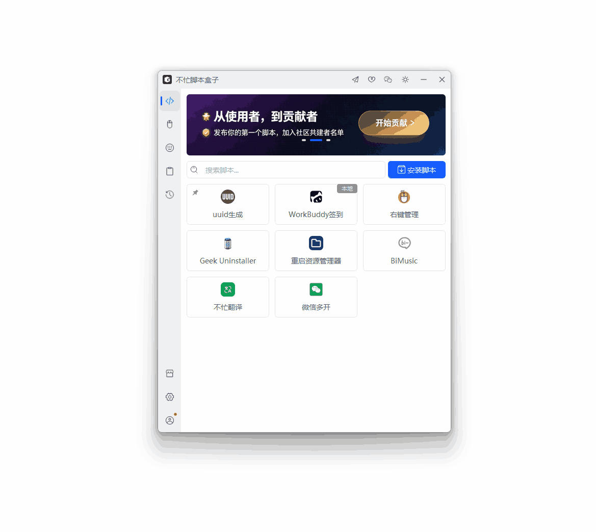

# WorkBuddy 自动签到

> 通过不忙脚本盒子配置定时运行、可实现每天自动领取 WorkBuddy（腾讯 AI 编程助手）的每日签到积分，并全自动打理成长中心——领旅行礼物、派 Buddy 旅行、接任务、断登补登、连登兑换、开盲盒，一键运行，定时无忧。

---

## 核心特性

- **每日自动签到**：到点自动领取当日积分，连续签到不中断
- **成长中心全自动**：领旅行礼物、派 Buddy 旅行、自动领取新任务与任务奖
- **断登自动补登**：有补登卡时自动补上断签，保住连登天数
- **连登奖励兑换**：连登满 7 / 14 / 28 天自动兑换入门/进阶/巅峰奖励
- **盲盒抽奖**：自动消耗抽奖机会与能量开盲盒、开 Buddy 盲盒
- **定时无人值守**：配合不忙脚本盒子定时任务每天自动运行
- **安全无密钥**：只读取本机登录态，不含任何第三方密钥，令牌绝不外泄

---

## 脚本演示

---

## 安装方法

本脚本的运行环境与定时调度均依赖「不忙脚本盒子」，建议仅通过盒子安装和使用本脚本。

> 前置条件：安装好 [不忙脚本盒子](https://www.bm-box.cn)，并已在电脑上登录过 WorkBuddy 桌面端（脚本读取本机登录态）

* 打开盒子 → **脚本市场** → 搜索 **「WorkBuddy 自动签到」**
* 点击「安装」

---

## 使用方式

* 直接启动（手动签到）
  * 在盒子里点击脚本卡片
  * 会先弹出**参数窗口**：选择运行模式（默认「签到+成长中心」），可改时间预算或填凭据路径
  * 点击「执行」后自动弹出终端，实时显示执行进度（查询状态 → 领取积分 → 成长中心各模块）
  * 完成后展示结果 JSON，**倒计时 5 秒自动关闭终端**
* 定时任务（每日自动签到）
  * 在盒子中新建定时任务，选择本脚本
  * 运行模式保持默认「签到+成长中心」，频率设为每天
  * 建议再设一个每 4 小时的轮询任务兜底：既补签，也能及时领回 Buddy 旅行礼物

---

## 💡 使用提示

* **运行模式**：默认 `签到+成长中心`（auto）；调试可用 `仅查签到状态`、`离线检查凭据`（不解密、不联网）
* **时间预算**：单次运行网络请求时间预算，默认 0 = 使用脚本内置值（签到 420 秒）；改小可让脚本提前收尾
* **凭据路径**：自动探测失败时，可手动指定 `workbuddy-desktop.info` 的完整路径
* **数据安全**：脚本只读取本机登录态；输出中的令牌统一脱敏，可放心查看日志

---

## 🖥️ 环境要求

| 项目 | 要求 |
| --- | --- |
| **操作系统** | Windows 10+（64 位） |
| **运行环境** | Python 3.8+（盒子自动准备） |
| **前置登录** | 已安装并登录 WorkBuddy 桌面端 |

---

## 🙏 致谢

本脚本的签到与成长中心逻辑基于开源项目 [workbuddy-auto-signin](https://github.com/88lin/workbuddy-auto-signin)（作者 [88lin](https://github.com/88lin)，MIT 协议）改造而来。本项目仅做不忙脚本盒子的接入封装与运行体验增强，签到接口逆向、凭据处理等核心工作均来自原项目，向原作者致敬。